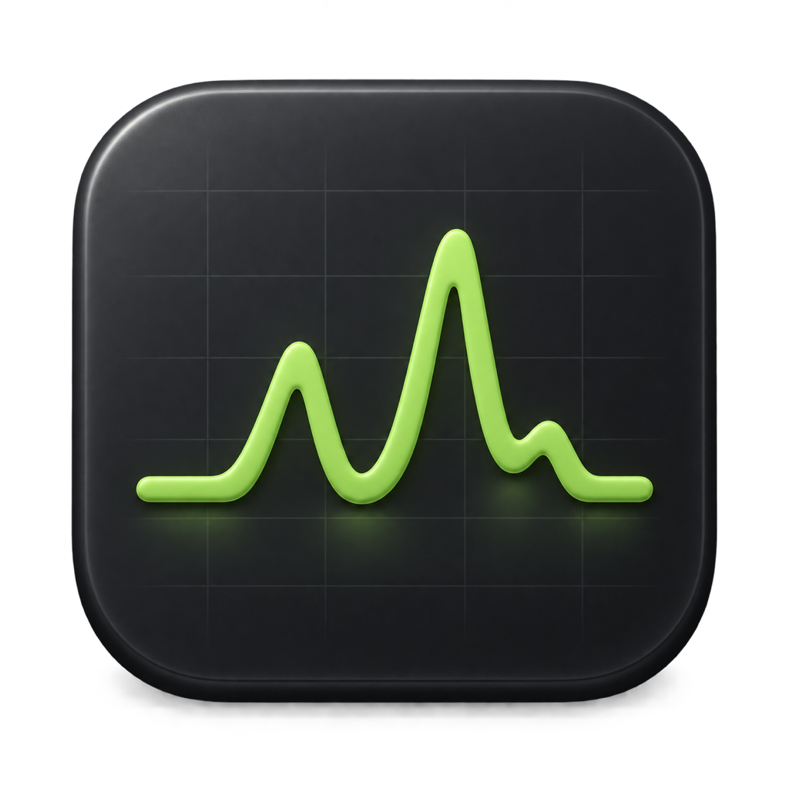
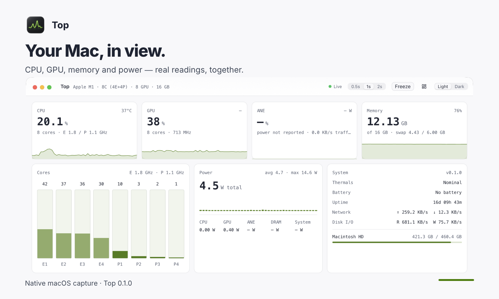
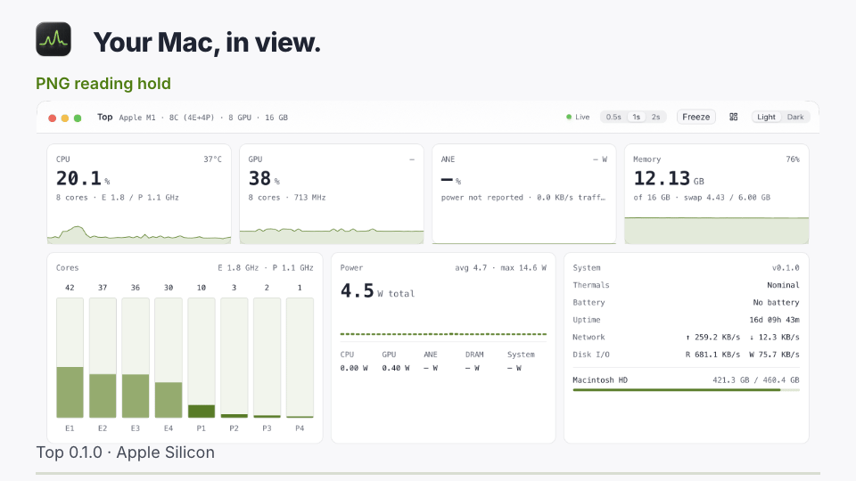
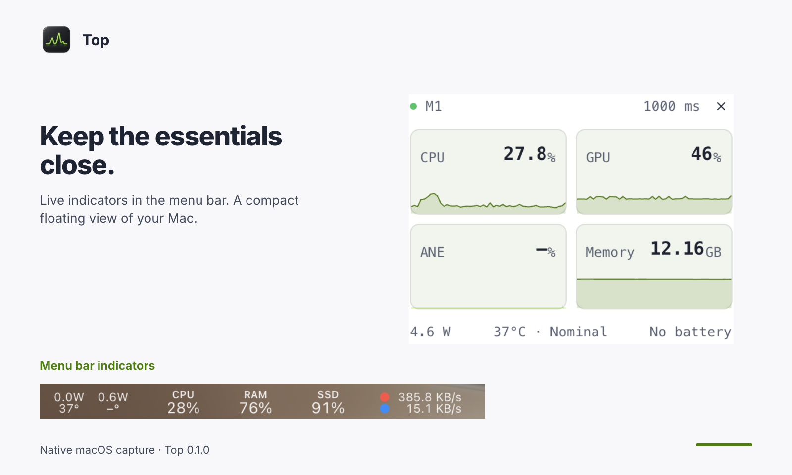

<div align="center">



# Top

**See your Mac's activity in the menu bar, dashboard, and process list.**

A native system monitor for Apple Silicon Macs.

macOS 14+ · Apple Silicon

[Quick tour](#quick-tour) · [Installation](#installation) · [First use](#first-use) · [User guide](docs/usage.md) · [Development](docs/development.md)

</div>



## Features

- **Live metrics.** Follow CPU, GPU, memory, disk and network activity, with power and temperature readings where available.
- **Your menu bar.** Choose the indicators you want; click one for a compact overview and the busiest processes.
- **A useful process list.** Search by command, user, or PID, sort columns, and freeze readings while you inspect them.
- **Keep it nearby.** Use the floating widget for headline metrics, or arrange the dashboard tiles to suit your screen.
- **Signed updates.** Install notarized releases and choose Stable or Beta through Sparkle's native updater.

## Quick tour

[](docs/media/tutorial.mp4)

**[Watch the 36-second walkthrough](docs/media/tutorial.mp4)** — read the
dashboard, inspect a process, and see the menu bar and floating widget. It
includes eight seconds of real native footage at 1× and clearly labelled
reading holds on captured screenshots.



Captured from the signed Top **0.1.0** release on an Apple M1 Mac using Cap,
then composed in HyperFrames. Readings reflect that capture, not a benchmark.
See [media provenance and portable source](docs/media/README.md).

## Installation

```sh
brew install --cask bshk-app/tap/top
```

Or download the Apple Silicon DMG from
[GitHub Releases](https://github.com/bshk-app/top/releases), open it, and move
**Top.app** to **Applications**. Releases are Developer ID signed, notarized,
and stapled. Intel Macs, Windows, and Linux are not release targets.

## First use

1. **Launch Top.** Open it from Applications and let the first sensor readings arrive.
2. **Choose your indicators.** Click a Top menu bar indicator, then use the popover's **Menu bar** checkboxes to select what stays visible.
3. **Look closer.** Select **Open Top** for the dashboard. Search the process list, or use **Window → Floating Widget** to keep headline metrics nearby.

Press **F** to freeze/resume dashboard readings and **/** to focus process
search. Choose **Top → Check for Updates…** for a manual update check, or
**Top → Update Channel → Stable/Beta** to select a channel. Stable is the default.

All menu bar indicators, including Network, can be disabled in the popover.
The selection is saved between launches. To restore hidden indicators,
activate Top from the Dock and choose **Window → Menu Bar…**.

## Measurements and privacy

- ANE load is a power-based estimate, not measured Neural Engine occupancy. Some hardware counters are unavailable on particular chips or macOS versions; missing sensor readings are shown as dashes.
- Per-process CPU is a share of one core, so a multithreaded process can exceed 100%. Readings describe sampled activity, not a performance benchmark.
- Metrics come from local macOS counters. Preferences are saved locally; Sparkle update checks and downloads contact GitHub. [The user guide](docs/usage.md#storage-and-updates) explains storage and update behavior.

## Documentation

- [User guide](docs/usage.md) — controls, shortcuts, readings, and troubleshooting for release 0.1.0.
- [Developer guide](docs/development.md) — prerequisites, source builds, project structure, and checks.
- [Release guide](docs/releases.md) — signing, notarization, update channels, Homebrew, and distribution recovery.
- [Native media](docs/media/README.md) — capture details, source ranges, verification, and the editable tutorial.
